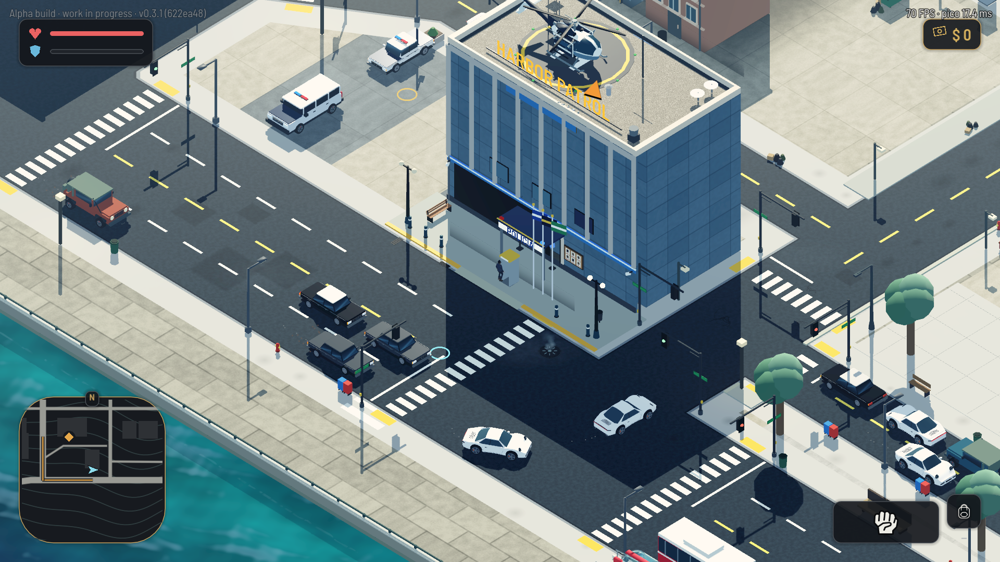
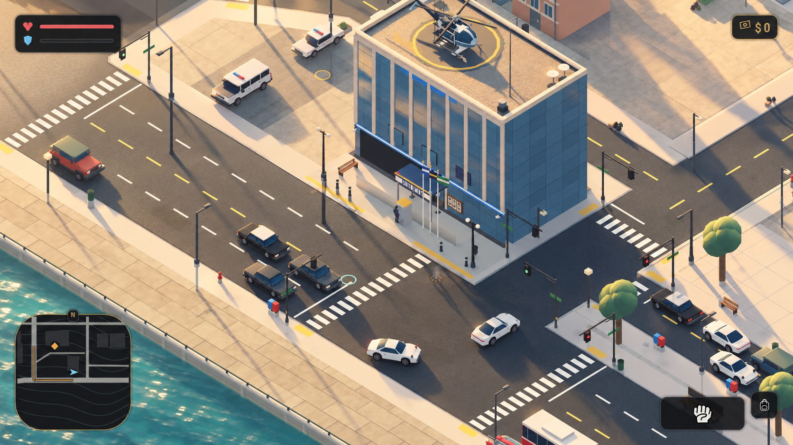
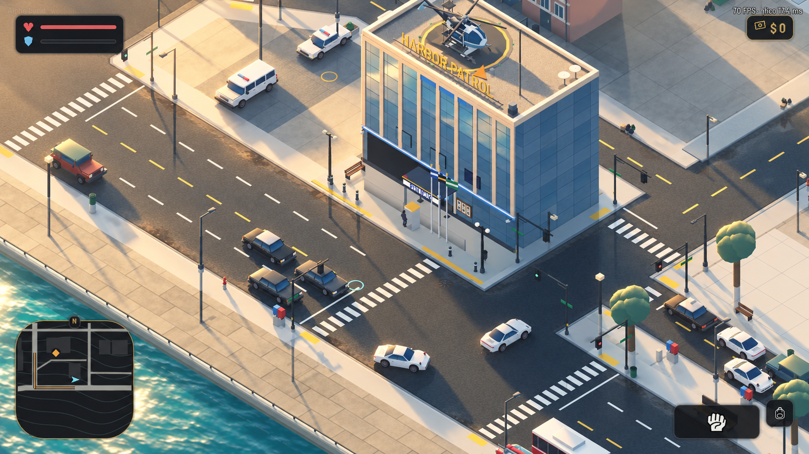
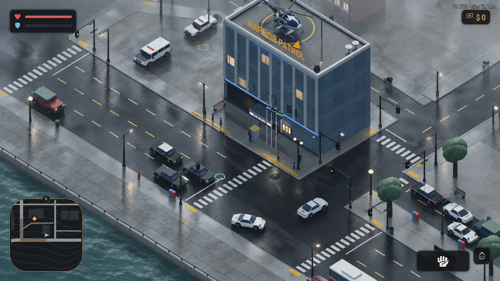

# Proposta de identidade visual do Geteco

**Diretriz reforçada pelo usuário:** nem tudo deve refletir. As imagens A/B/C continuam sendo o objetivo artístico, com reflexos concentrados em vidros e áreas de água; a maior parte da rua molhada mantém textura fosca. A identidade também depende de cor, luz, sombra e acabamento dos materiais.

Proposta de 13 de outubro de 2026 para dar presença aos materiais e uma atmosfera reconhecível ao jogo. A direção combina luz quente, preenchimento frio de maresia e reflexos seletivos, preservando a câmera elevada, as formas simples e a leitura da ação.

**Decisão posterior do usuário:** os três estudos passam a ser estados do tempo na cidade 1: A no tempo aberto, B no céu parcialmente encoberto e depois da chuva, C na chuva e tempestade. A implementação e suas capturas reais são acompanhadas em [resultado do piloto](resultado-identidade-visual-20261013.md). As imagens abaixo continuam sendo conceitos, não evidência do motor.

## Direção principal

O Geteco deve parecer uma cidade costeira vivida: concreto claro aquecido pelo sol, água azul-esverdeada, sombras frias com detalhe, pintura com desgaste discreto e vidro que recebe a cor do ambiente. A personalidade deve continuar perceptível ao meio-dia, ao entardecer e à noite.

A assinatura visual proposta tem três componentes: **luz quente sobre materiais foscos; sombras frias que preservam a cor; brilhos concentrados em vidro, lataria e água**. O entardecer é a imagem de referência, mas o ciclo de horário continua funcionando normalmente.

Um momento que resume a intenção: ao passar do sol para a sombra de um prédio, o carro perde o brilho dourado direto, conserva sua cor e recebe um reflexo suave e frio do céu. O asfalto permanece fosco ao redor, tornando essa mudança visível.

## Estudos sobre a mesma esquina

A referência é a captura existente da delegacia junto ao canal, em `evidence/fleet-finish-20260928/glare-after-20260929/day.png`. Ela reúne água, vidro, calçada, árvores, carros e uma grande área sombreada. É uma captura histórica de setembro, não um registro novo da versão atual.

Os três estudos preservam esse enquadramento como laboratório de aparência. São imagens conceituais geradas, não screenshots de uma implementação. Diferenças incidentais produzidas pela geração não fazem parte do escopo de alteração do mapa ou da interface.

| Estudo | Tratamento | Papel na proposta |
| --- | --- | --- |
| A — Calor e poeira | Sol de mel claro, concreto areia, sombras azuladas, asfalto seco e distância levemente quente | Tempo aberto, mais dourado ao entardecer |
| B — Calor e maresia | Sol marfim, sombra azul-esverdeada, umidade discreta à distância, vidro frio e lataria com brilhos quentes | Céu parcialmente encoberto e umidade restante depois da chuva |
| C — Concreto e neblina | Luz encoberta, cinzas frios, saturação menor, brilho prateado e distância mais fechada | Chuva e tempestade na cidade 1 |

A e B devem manter horário e enquadramento próximos para comparar o tratamento. C muda intencionalmente a condição de luz. A cidade 4 continua com sua própria direção permanentemente mais escura e acinzentada; esta decisão de clima não altera esse contrato.

### Referência histórica

### A Calor e poeira

### B Calor e maresia

Esta é a referência principal. No piloto, moderar o brilho da água e dos carros brancos para preservar detalhes durante o movimento.

### C Concreto e neblina

O estudo C é a referência do estado molhado. Quando a chuva termina, o piso deve secar gradualmente. A cidade 4 não deve depender de chuva permanente para ter identidade.

As imagens foram produzidas com a ferramenta integrada `image_gen.imagegen`; os [prompts completos](concepts/identidade-visual-20261013/prompts.json) acompanham os arquivos. Elementos da interface e contadores de FPS reproduzidos nas imagens são parte da referência visual e não representam medições dos conceitos. Pequenas alterações de modelos, letras e sombras feitas pela geração não são propostas de redesign.

## Paleta de autoria

Estas cores são referências para o estudo, não valores finais de materiais ou parâmetros do motor. A luz ainda precisa preservar as diferenças entre carros, personagens e sinalização.

| Papel | Referência | Uso |
| --- | --- | --- |
| Luz de sol | `#F2D7A7` | Calor nas superfícies iluminadas, sem amarelar a imagem inteira |
| Concreto claro | `#BEB6A5` | Calçadas e fachadas, com variação ampla e sutil |
| Sombra fria | `#536777` | Preenchimento legível nas áreas protegidas do sol |
| Mar e vidro | `#527C80` | Identidade costeira e resposta fria do ambiente |
| Asfalto seco | `#424A50` | Base fosca que destaca veículos e faixas |
| Luz noturna quente | `#E7BA80` | Acentos nas fontes existentes, intercalados com luz neutra |

## Resposta dos materiais

| Material | Resultado desejado | Evitar |
| --- | --- | --- |
| Lataria | Brilho amplo e suave que acompanha forma, luz e movimento; cor identificável no sol e na sombra | Mancha branca que apaga a pintura; verniz igual em toda peça |
| Vidro | Gradiente do ambiente e reflexo mais evidente em ângulos rasantes; separação clara de carroceria e parede | Placa azul uniforme; faixas brancas fixas que parecem adesivos |
| Asfalto | Predominantemente fosco, variação discreta de desgaste e remendos coerentes com a escala | Piso espelhado permanente; ruído fino cintilando na câmera distante |
| Calçada e parede | Variação de tom e rugosidade, contato convincente com o chão, detalhes ainda legíveis nas áreas claras | Branco estourado; sujeira distribuída igualmente por tudo |
| Metal | Pequenos brilhos localizados em corrimãos, estruturas e acabamentos | Transformar metal pintado ou oxidado em cromo |
| Água | Reflexo suave de luz e ambiente, movimento contido e coerente | Espelho imóvel; brilhos agressivos que competem com a rua |
| Vegetação | Separação entre folhas iluminadas e massa em sombra, com verdes moderados | Aparência plástica ou brilho semelhante à lataria |

Reflexo do ambiente, brilho de uma fonte e reflexo identificável de objetos são recursos distintos. O piloto prioriza os dois primeiros. Reflexos de carros, fachadas e pessoas em superfícies devem ser tratados como uma etapa separada, dependente de viabilidade visual e custo medido.

Na chuva, áreas expostas podem escurecer e apresentar brilho irregular. Poças devem ocupar depressões e bordas plausíveis; superfícies cobertas precisam manter resposta distinta. Seco, molhado e secando devem ter transições suaves vinculadas ao clima.

## Atmosfera na câmera do jogo

A câmera elevada mostra principalmente o chão. Por isso, névoa forte demais pode virar uma camada leitosa sobre a pista. O objetivo é separar planos distantes e preservar personagem, obstáculos, faixas e semáforos próximos. A quantidade deve ser julgada nas câmeras e distâncias reais de gameplay.

De manhã, usar luz suave e ar discretamente frio. Ao meio-dia, manter contraste entre materiais sem depender de uma dominante laranja. No entardecer, acentuar a relação entre sol quente e sombra fria. À noite, manter o chão e os personagens legíveis, com ilhas de luz quente e neutra e ambiente frio. Evitar transformar toda janela em luz âmbar.

Na montanha, a mesma lógica de materiais pode usar ar mais frio, neve com detalhe e abrigo visualmente acolhedor, respeitando o padrão existente de interiores. No deserto, predominam distância quente e superfícies secas. A cidade 4 preserva sua direção mais escura, acinzentada e com neblina. Essas adaptações são diretrizes futuras; o piloto fica na cidade 1.

## Base existente e abordagem técnica

O projeto já possui controles de atmosfera, sombras coloridas e acabamento de superfícies. A sensação relatada de visual flat orienta a revisão da composição e da resposta visível desses recursos, sem presumir ausência completa de iluminação ou materiais.

| Ponto existente | Uso previsto no piloto |
| --- | --- |
| `runtime/atmosphere/RegionalAtmosphere3D.gd` | Ajustar em conjunto luz, preenchimento, saturação e névoa regional |
| `runtime/Weather.gd` | Preservar a relação entre horário, clima e ambiente |
| `runtime/VehicleFinish.gd` e `runtime/VehiclePaint.gd` | Conferir a resposta de vidro e pintura no caminho efetivamente usado pelo veículo selecionado |
| `world/city_look/CityLookMaterials.gd` | Diferenciar vidro, superfícies foscas e luz noturna |
| `world/city_look/CityLocalLighting.gd` | Preservar a seleção e continuidade das fontes próximas |

O `project.godot` consultado configura o renderer Mobile. O protótipo deve partir dessa configuração e do Godot 4.7.2 .NET do projeto; recursos adicionais de reflexão dependem de confirmação de suporte e medição antes de adoção. Priorizar materiais e ambiente compartilhados, evitando atualizações por frame por objeto e multiplicação de fontes.

O código atual de `VehicleFinish.gd` desliga o clearcoat da pintura para evitar um segundo brilho branco sobre painéis planos. Esse cuidado deve ser preservado durante a exploração. Aumentar brilho indiscriminadamente pode recuperar um problema já tratado.

## Piloto jogável proposto

1. **Registrar a base atual.** Usar a esquina da delegacia junto ao canal, com câmera, posição, veículo, horário, clima e população registrados. Reutilizar um carro claro e um escuro para verificar os dois extremos de pintura. Capturar o visual e medir antes de editar.
2. **Ajustar luz e atmosfera.** Aplicar a direção B apenas no trecho ou modo de comparação do piloto. Comparar com a base nas mesmas condições, mantendo a geometria.
3. **Ajustar os materiais principais.** Priorizar carro, vidro da fachada, calçada, asfalto e água. Verificar quais materiais e shaders realmente chegam às superfícies visíveis, inclusive nos modelos redesenhados.
4. **Adicionar umidade seletiva.** Avaliar somente depois de a versão seca funcionar. Separar alteração de material e novos efeitos para localizar seus custos.
5. **Validar movimento e ciclo.** Percorrer sol e sombra, girar a câmera, atravessar limites de ativação, sair e voltar ao trecho e observar dia, entardecer, noite e chuva.
6. **Expandir após avaliação.** Levar a receita a um segundo trecho representativo antes de adotá-la regionalmente. Interiores e outros mapas exigem revisão própria dos contratos aplicáveis.

O piloto não redesenha ruas, altera missões ou acrescenta textos decorativos. Fachadas conservam somente os nomes próprios e textos funcionais permitidos pelo projeto.

## Critérios de avaliação do piloto

O visual estará pronto para expansão quando vidro, lataria, asfalto e concreto forem distinguíveis na câmera normal; cores dos carros sobreviverem ao sol; personagens permanecerem legíveis em sombra e à noite; e a atmosfera tiver identidade também fora do entardecer. O contraste deve vir da luz e dos materiais, sem contornos de brilho artificiais em todos os objetos.

A validação futura segue `testes-com-criterio`, `performance-do-jogo` e `validar-iluminacao`: usar a cena real renderizada com tráfego e NPCs, comparar a mesma configuração antes/depois, guardar evidência temporal contínua por pelo menos 30 segundos em cada condição crítica e inspecionar movimento e limites. Screenshot e estudo gerado não comprovam estabilidade temporal.

Referência inicial: 60 FPS / 16,67 ms no hardware de comparação, com configuração efetiva registrada. Separar aquecimento e primeira visita do regime estável; reportar p50, p95, p99, máximo e quadros acima de 33,3 e 66,7 ms. Aumento superior a 5% em p95 ou p99 pede confirmação dirigida e finita. Regressão confirmada, flickering involuntário ou perda de leitura impede aprovação. Contratos existentes de atmosfera, clima e acabamento devem ser reutilizados conforme os sistemas efetivamente alterados.

Esta entrega contém a proposta e os estudos artísticos. Implementação, estabilidade temporal e performance do novo visual permanecem pendentes do piloto renderizado; os benchmarks históricos não aprovam esta direção.

## Referências do projeto

- [Migração da atmosfera regional](regional-atmosphere-migration.md)
- [Iluminação externa](outdoor-lighting-20260928.md)
- [Acabamento da frota e limitações da medição histórica](fleet-visual-finish.md)
- [Padrão dos interiores](interior-standard.md)
- [Validação de iluminação](skills/validar-iluminacao/SKILL.md)
